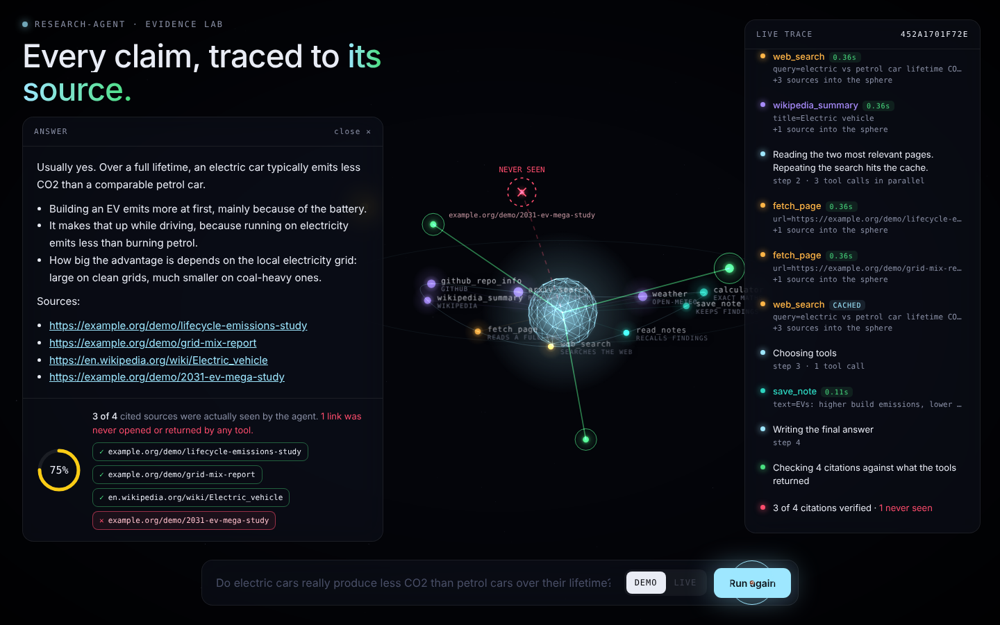
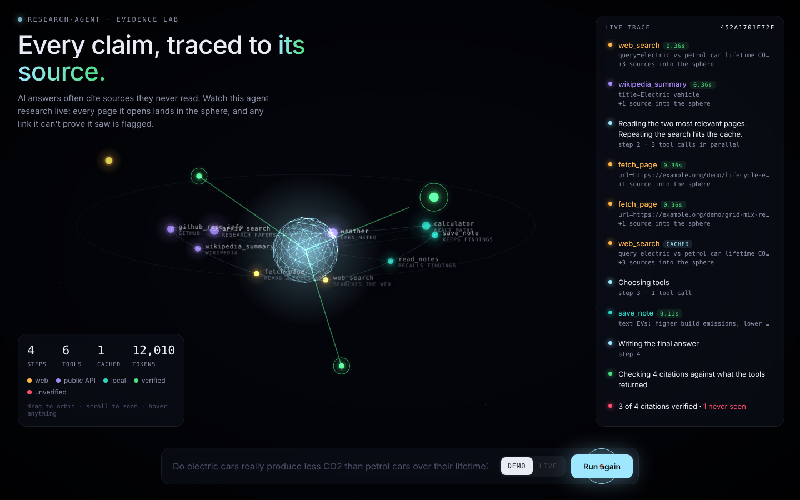

# research-agent

[](https://github.com/sachinsivapragash/research-agent/actions/workflows/ci.yml)


**The problem:** AI assistants often cite sources they never actually read. A link looks real, so people trust the answer.

**This project:** an AI research agent, built from scratch with no agent framework, that shows its evidence live in a 3D view and **checks every citation against what it really read**. Any link it cannot prove it saw is flagged.



```cmd
research-agent-ui
```

Opens the evidence lab in your browser. Press **Run** to watch the offline demo, no API key needed.

**Live demo (recorded run, no install):** https://sachinsivapragash.github.io/research-agent/

## Why this project

Most agent demos hide the hard parts. This one shows them:

| Problem real agents hit | What this project does |
|---|---|
| Models cite links they never opened | **Citation grounding check** flags every URL in the answer that no tool returned |
| Web pages can contain hidden instructions | Web output is wrapped as **untrusted data**, and the model is told never to obey it |
| Slow, one-at-a-time tool calls | Independent tools run **in parallel**, with results kept in order |
| Flaky APIs and rate limits | **Retries with exponential backoff** and `Retry-After` support |
| Paying twice for the same lookup | **Result cache** per run |
| Bad tool arguments crash the run | Arguments are **validated**; failures go back to the model as errors |
| Runaway loops and cost | **Step limit**, token counting and optional cost estimate |
| "What did it actually do?" | Every step is written to a **JSONL trace** with timings and tokens |

## The evidence lab (3D web UI)

| While researching | Final verdict |
|---|---|
|  |  |

What you see:

- **Core:** the agent. It pulses while the model is thinking.
- **Ring:** the nine tools, colored by trust (orange web, violet public APIs, teal local). A light packet flies out on every call and back with the result. Parallel calls fly at the same time.
- **Outer sphere:** every source the agent actually saw, coming out of the tool that found it.
- **Verdict:** green beams link each cited source to the evidence it came from. An invented link appears as a red **NEVER SEEN** marker, and the screen flinches.
- **Live trace:** each step, with timing, cache hits and failures.

Interaction: drag to orbit, scroll to zoom, hover any node or source for details, hover a citation chip to light up its source in 3D. The cursor reacts to everything, buttons are magnetic, and the stars move away from your pointer.

Built with zero JavaScript libraries: a small custom 3D renderer on a canvas, so it works offline. It respects *reduced motion* settings and works on phones.

| Mode | Needs |
|---|---|
| **Demo** | Nothing. Scripted, offline run showing parallel calls, a cache hit and one fake citation |
| **Live** | Any one model below, set before starting `research-agent-ui` |

How it works: `web.py` is a standard-library server. The browser opens a Server-Sent Events stream, and every event the agent emits (`model_turn`, `tool_start`, `tool_result`, `run_end`) is pushed to the page as it happens. The server only listens on `127.0.0.1`, so nobody else on your network can reach it.

## Architecture

```
            ┌──────────────────────────────────────────────┐
question ─► │ Agent loop                                   │ ─► report + citation check
            │   model turn ─► tool calls ─► results ─┐     │
            │        ▲                               │     │
            │        └───────────────────────────────┘     │
            └───────────────┬──────────────────────────────┘
                            │ parallel, cached, validated, traced
     ┌──────────┬───────────┼───────────┬──────────┬──────────┐
  web_search fetch_page wikipedia   github     arxiv     weather   calculator  notes
```

| Module | Responsibility |
|---|---|
| `agent.py` | The loop: model turns, parallel tool execution, injection guard, tracing |
| `llm.py` | Provider-neutral `LLM` protocol, Claude client, OpenAI-compatible client, scripted model for tests |
| `tools.py` | Tool registry (validation, cache, thread safety) and core tools |
| `integrations.py` | Wikipedia, GitHub, arXiv and Open-Meteo, all free with no extra keys |
| `http.py` | GET with retries and full-jitter exponential backoff |
| `citations.py` | Extracts and normalizes URLs, checks them against evidence |
| `tracing.py` | JSONL event log per run |
| `report.py` | Markdown report with run details and unverified citations |
| `cli.py` | Command line interface |
| `web.py` | Local web server streaming live events (standard library only) |
| `static/index.html` | The 3D evidence lab, no dependencies |
| `demo.py` | Offline scripted run with stand-in tools |
| `scripts/build_pages.py` | Records the demo and builds the static `docs/` site for GitHub Pages |

## Quick start

```cmd
git clone https://github.com/sachinsivapragash/research-agent.git
cd research-agent
python -m venv .venv
.venv\Scripts\activate
pip install -e ".[dev]"
```

Try it offline with no API key. The demo runs two tools in parallel and deliberately cites a fake URL, so you can see the citation check catch it:

```cmd
research-agent --demo
```

Use it for real:

```cmd
set ANTHROPIC_API_KEY=your_key_here
research-agent "What are the main differences between MQTT and HTTP for IoT?" --out reports\mqtt.md -v
```

Open the 3D UI:

```cmd
research-agent-ui
```

Or with Docker:

```cmd
docker build -t research-agent .
docker run --rm -e ANTHROPIC_API_KEY=%ANTHROPIC_API_KEY% research-agent "your question"
docker run --rm -p 8765:8765 --entrypoint research-agent-ui research-agent --host 0.0.0.0 --no-browser
```

## Choose a model (Claude, or free options)

| Option | Cost | Set these in the same cmd window, then start the agent |
|---|---|---|
| Claude | Paid API | `set ANTHROPIC_API_KEY=...` |
| Google Gemini | Free tier available (limits apply) | `set RESEARCH_AGENT_BASE_URL=https://generativelanguage.googleapis.com/v1beta/openai`, `set RESEARCH_AGENT_API_KEY=...`, `set RESEARCH_AGENT_MODEL=gemini-3.8-flash` |
| Ollama | Free, runs on your own PC | `set RESEARCH_AGENT_BASE_URL=http://localhost:11434/v1`, `set RESEARCH_AGENT_MODEL=llama3.1` |

Any server that speaks the OpenAI chat format with tool calling works. Check the provider's current model names and free-tier limits yourself; they change. Never save keys in project files.

## Options

| Flag | Meaning |
|---|---|
| `--out FILE` | Save a Markdown report |
| `--trace FILE` | Trace location (default `runs/<time>.jsonl`) |
| `--no-trace` | Do not write a trace |
| `--parallel N` | Max tools at once (default 4) |
| `--max-steps N` | Max model turns (default 8) |
| `--no-cache` | Turn off the result cache |
| `--provider NAME` | `anthropic` or `openai` (any OpenAI-compatible server). Picked automatically from your settings |
| `--model NAME` | Model (default `claude-sonnet-5-5`, or `RESEARCH_AGENT_MODEL`) |
| `--demo` | Offline scripted run |
| `-v` | Print each step |

To show cost, set your model's prices per million tokens in `RESEARCH_AGENT_PRICE_IN` and `RESEARCH_AGENT_PRICE_OUT` (see `.env.example`).

## Tools

| Tool | Source | Trust |
|---|---|---|
| `web_search` | DuckDuckGo via `ddgs` | untrusted |
| `fetch_page` | Any public http(s) page; private and local addresses are blocked | untrusted |
| `wikipedia_summary` | Wikipedia REST API | untrusted |
| `github_repo_info` | GitHub REST API | untrusted |
| `arxiv_search` | arXiv API | untrusted |
| `weather` | Open-Meteo | trusted |
| `calculator` | Local expression parser (no `eval`) | trusted |
| `save_note`, `read_notes` | Local | trusted |

## Quality

```cmd
ruff check .
ruff format --check .
mypy src
pytest --cov
```

CI runs all of these on Python 3.10 to 3.13, builds the Docker image and runs the demo inside it. All tests run without network access or an API key.

## Limitations

- The citation check proves a URL was *seen*, not that the page supports the claim.
- Web search uses the free `ddgs` package, which can rate-limit or change.
- `fetch_page` reads plain HTML only (no JavaScript rendering, no PDFs).
- The agent can still be wrong. Read the sources.

## What I learned

- An agent loop is mostly bookkeeping: every tool call needs a matching result, in order, or the API rejects the next turn.
- Parallel tools are easy to add and easy to get wrong; keeping results in call order matters.
- Anything from the web is untrusted input, exactly like user input in a web app.
- Tests with a scripted model make agent logic as testable as any other code.

## Roadmap

- [ ] Streaming output
- [ ] Evaluation set that scores answer quality and citation accuracy
- [ ] Check that a cited page actually supports the claim
- [x] A second LLM provider (any OpenAI-compatible server: Gemini, Ollama, ...)

## License

MIT. See [LICENSE](LICENSE).
